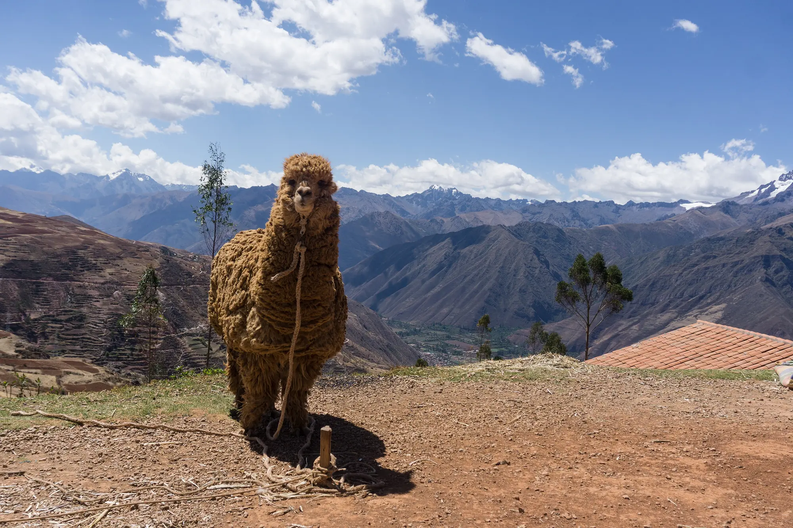

# Cusco – Where the Sky Meets the Soul


A premium cinematic tourism site built with **Next.js 14**, **Tailwind CSS**, **Three.js**, and **Framer Motion**.  It showcases the stunning landscapes of Cusco, Peru, with immersive video, animated galleries, and smooth scroll interactions.

---

## ✨ Highlights

- **Hero video**: Looping Machu Picchu timelapse with parallax effects.
- **Dynamic journeys**: Interactive cards that reveal details on hover.
- **Story section**: Personal travel anecdotes with portrait images.
- **Responsive gallery**: Masonry‑style layout using Next Image with blur placeholders.
- **Three‑JS scene**: Interactive 3D view of Machu Picchu.
- **Tailwind dark mode**: Ready for a dark theme toggle (class‑based).

---

## 📸 Gallery (preview)

|  |  |  |
|---|---|---|
| Alpaca | Machu Picchu at sunrise | Sacsayhuamán walls |

> Add more images to `public/images/` and they will automatically appear in the **Gallery** section.

---

## 🚀 Getting Started

```bash
# Install dependencies
npm install

# Development server
npm run dev

# Build for production
npm run build && npm start
```

---

## 📚 Scripts Overview

| Script | Description |
|--------|-------------|
| `dev`   | Starts the Next.js development server with hot‑reloading. |
| `build` | Compiles the app for production. |
| `start` | Serves the optimized build. |
| `lint`  | Runs ESLint checks. |

---

## 🤝 Contributing

1. Fork the repository.
2. Create a feature branch (`git checkout -b feat/awesome-feature`).
3. Add new images to `public/images/` and reference them in the `gallery` array (`src/data/content.ts`).
4. Submit a Pull Request.

---

## 📜 License

MIT © 2024‑2026 Cusco Travel Team

